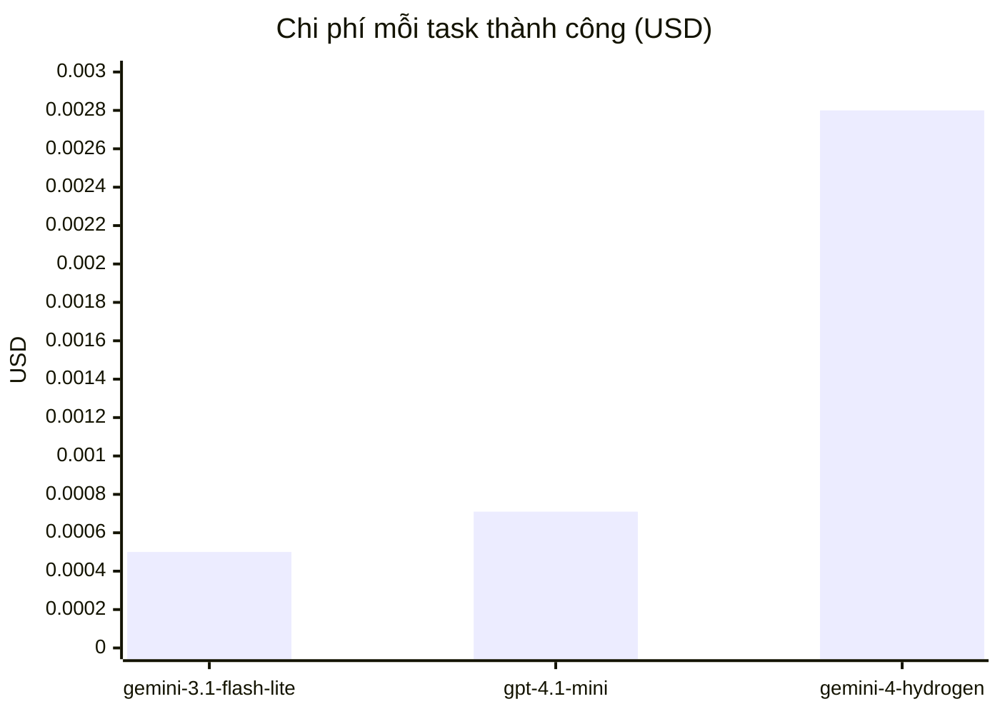
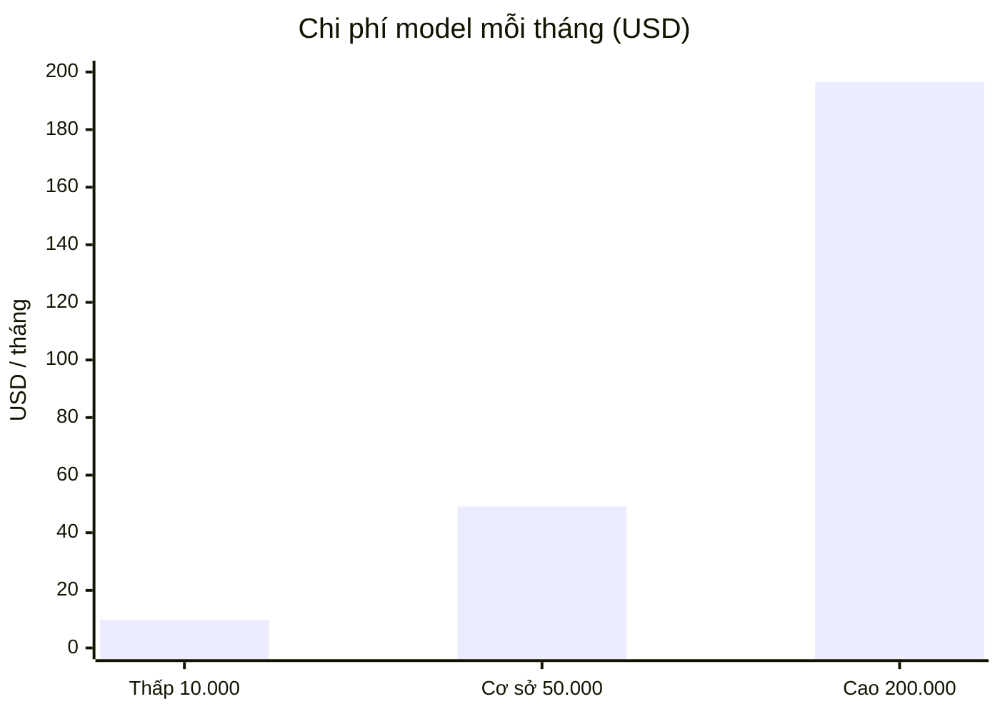

# Chi phí khi dùng thật

> Điền ở guide bước 4.2, nộp ở CP4 14:30 Thứ Bảy 28/11. Ôn lại: ngày 13, ngày 1, ngày 14 · lab ngày 13, lab ngày 14. Chấm ở rubric R6.
> Số ở mục 2 chép từ [`simulate-1-summary.md`](simulate-1-summary.md). Số tính thêm ở mục 3–4 ghi rõ cách tính.
> Lúc build dùng gói miễn phí vẫn tính theo **giá gói trả phí** — đây là chi phí cho lúc đưa vào dùng thật.

## 1. Đầu vào

**Persona** ([`personas.yaml`](personas.yaml)):

| Persona | Tỉ lệ | Phiên / người / tháng | Lượt hỏi / phiên | Nguồn |
|---|---:|---:|---:|---|
| `dung_it` | 75% | 0,2 | 1 | Tỉ lệ: khảo sát n=40 câu 6 (30/40). Hai số còn lại *(tự ước tính)*, 0,2 theo `spec.md` §2 |
| `dung_vua` | 15% | 1,5 | 2 | Tỉ lệ: khảo sát câu 6 (6/40). Hai số còn lại *(tự ước tính)* |
| `dung_nhieu` | 10% | 3,5 | 3 | Tỉ lệ: khảo sát câu 6 (4/40). Hai số còn lại *(tự ước tính)* |

Câu 6 đếm số lần gặp giao dịch bất thường hoặc tin nhắn nghi lừa đảo, không đếm phiên chat. Dùng nó làm tần suất chat là giả định mỗi lần gặp thành một phiên, nên chi phí nghiêng về cận trên.

- **Số người dùng** *(tự ước tính)*: thấp 10.000 (cùng quy mô giả định ở `spec.md` §2) · cơ sở 50.000 · cao 200.000 người dùng/tháng.
- **Giá** (USD / 1 triệu token vào · ra, xem 28/11/2026):

| Model | Vào | Ra | Nguồn |
|---|---:|---:|---|
| `openai/gpt-4.1-mini` | 0,40 | 1,60 | [openrouter.ai/api/v1/models](https://openrouter.ai/api/v1/models) |
| `gemini-3.1-flash-lite` (tầng nhỏ) | 0,25 | 1,50 | [Giá Gemini API](https://ai.google.dev/gemini-api/docs/pricing) và OpenRouter |
| `gemini-4-hydrogen` (tầng lớn) | 1,50 | 7,50 | [Giá Gemini API](https://ai.google.dev/gemini-api/docs/pricing) và OpenRouter |

- **Tỉ lệ đạt:** 21/25 (84%), lượt `run-2@20261128-121029`. Nhật Minh chưa kiểm chéo lượt này; chấm chặt 4 câu lưỡng lự thì còn 18/25 (xem [`eval/report.md`](../eval/report.md)).
- **Token đo trên** `openai/gpt-4.1-mini`, **tính giá thêm cho** `gemini-3.1-flash-lite` và `gemini-4-hydrogen`. Hai model Gemini chưa chạy thử: token và tỉ lệ đạt của chúng có thể khác.
- Tỷ giá 1 USD = 25.687 ₫ (tỷ giá trung tâm NHNN 27/11/2026, [theo báo](https://thitruongtaichinhtiente.vn/ngay-27-11-ty-gia-trung-tam-tang-11-dong-87350.html)).

## 2. Kết quả mô phỏng

Lượt mô phỏng: [`simulate-1.csv`](simulate-1.csv) · run ID `simulate-1@20261128-121324` · 50 phiên (60 lượt hỏi) · seed 42 · 0 phiên lỗi.

| Persona | Số phiên | Lượt hỏi / phiên | Token vào / phiên | Token ra / phiên | Gọi model / phiên | Gọi công cụ / phiên |
|---|---:|---:|---:|---:|---:|---:|
| `dung_it` | 41 | 1 | 976 | 77 | 1,6 | 2,8 |
| `dung_vua` | 8 | 2 | 1.556 | 131 | 2,8 | 4,5 |
| `dung_nhieu` | 1 | 3 | 3.797 | 333 | 6,0 | 8,0 |

| Model | Chi phí / phiên | Chi phí / task thành công | / tháng — thấp | / tháng — cơ sở | / tháng — cao | / người / tháng (cơ sở) |
|---|---:|---:|---:|---:|---:|---:|
| `openai/gpt-4.1-mini` | $0.00059 (≈ 15 ₫) | $0.00071 (≈ 18 ₫) | $9.82 (≈ 252.327 ₫) | $49.12 (≈ 1.261.634 ₫) | $196.46 (≈ 5.046.537 ₫) | $0.00098 (≈ 25 ₫) |
| `gemini-3.1-flash-lite` | $0.00042 (≈ 11 ₫) | $0.00050 (≈ 13 ₫) | $6.93 (≈ 177.945 ₫) | $34.64 (≈ 889.725 ₫) | $138.55 (≈ 3.558.899 ₫) | $0.00069 (≈ 18 ₫) |
| `gemini-4-hydrogen` | $0.0024 (≈ 61 ₫) | $0.0028 (≈ 72 ₫) | $39.20 (≈ 1.006.948 ₫) | $196.00 (≈ 5.034.739 ₫) | $784.01 (≈ 20.138.954 ₫) | $0.0039 (≈ 101 ₫) |

Chi phí / task thành công = chi phí trung bình mỗi phiên ÷ tỉ lệ đạt — **không coi như đạt 100%**.

### Biểu đồ 1 · Chi phí / task thành công theo model (USD)

### Biểu đồ 2 · Chi phí model mỗi tháng theo quy mô, `openai/gpt-4.1-mini` (USD)

## 3. So với impact

- **Impact / người / tháng** (`spec.md` §2, *tự ước tính*): bảo vệ ≥ 75 triệu ₫/tháng trên 10.000 người = **≥ 7.500 ₫/người/tháng**. Con số này dựa trên giả định chặn được 5 ca/tháng × 15 triệu ₫/ca. Ngoài ra §2 ước tính tiết kiệm khoảng 167–660 giờ chờ/tháng.
- **Chi phí model / người / tháng** (cơ sở, `openai/gpt-4.1-mini`): **≈ 25 ₫**, bằng khoảng 1/300 impact giả định.
- **Điểm hòa vốn riêng chi phí model:** ở quy mô 10.000 người, chi phí một tháng ≈ 252 nghìn ₫. Chỉ cần giữ được một ca 15 triệu ₫ trong khoảng 59 tháng là đủ bù.
- **Chỗ lệch cần biết:** `spec.md` §2 giả định 500–2.000 ca/tháng trên 10.000 người, còn persona ở trên cho ra 7.250 phiên/tháng (0,725 phiên/người). Chi phí vì vậy đang tính trên lượng dùng cao hơn impact khoảng 3,6–14,5 lần.
- **Kết luận một dòng — đáng làm không:** Đáng làm xét riêng chi phí model, vì chi phí rất nhỏ so với giá trị bảo vệ giả định; kết luận này **chưa tính giờ công tư vấn viên** và phụ thuộc các số *tự ước tính* ở §2.

## 4. Độ nhạy và giới hạn

| Cần gạt | Tác động (từ `simulate-1`) |
|---|---|
| Đổi sang `gemini-3.1-flash-lite` | Chi phí / task thành công giảm khoảng 30% ($0.00071 → $0.00050), **nếu** tỉ lệ đạt giữ nguyên 84% (chưa kiểm) |
| Đổi sang `gemini-4-hydrogen` | Chi phí / task thành công tăng khoảng 4 lần ($0.0028) |
| Cắt ngữ cảnh | Token vào chiếm khoảng 76% chi phí, nên rút gọn dữ liệu đưa vào model là cần gạt lớn nhất |
| Câu bị chặn bằng code | Dò ngưỡng và ngoài phạm vi không gọi model, chi phí model bằng 0 |

**Số kém chắc nhất:** nhóm `dung_nhieu` chỉ rơi vào **1/50 phiên** nhưng chiếm khoảng **73%** chi phí tháng. Nếu tính 3 lượt của nhóm này theo chi phí trung bình mỗi lượt của cả lượt mô phỏng (≈ $0.0005), chi phí tháng mức thấp là khoảng $7.8 thay vì $9.82.

**Chi phí ngoài model (chưa quy ra tiền):**
- **Giờ công tư vấn viên:** 21/60 lượt hỏi (35%) tạo phiếu chuyển người. Ở quy mô cơ sở (khoảng 82.500 lượt hỏi/tháng) tương đương khoảng 29.000 phiếu/tháng. Tỉ lệ này lấy từ câu hỏi trong bộ thử loại `thuong` và `kho`, nhiều ca khẩn hơn thực tế, nên là cận trên. Đây nhiều khả năng là khoản lớn hơn chi phí model; nhóm chưa có số liệu lương hay thời gian xử lý.
- Hosting, lưu trữ trace, giám sát: chưa ước tính.
- Mỗi lượt hỏi chạy độc lập (bản mẫu không giữ lịch sử hội thoại); nếu thêm lịch sử, token vào mỗi lượt sẽ tăng.
